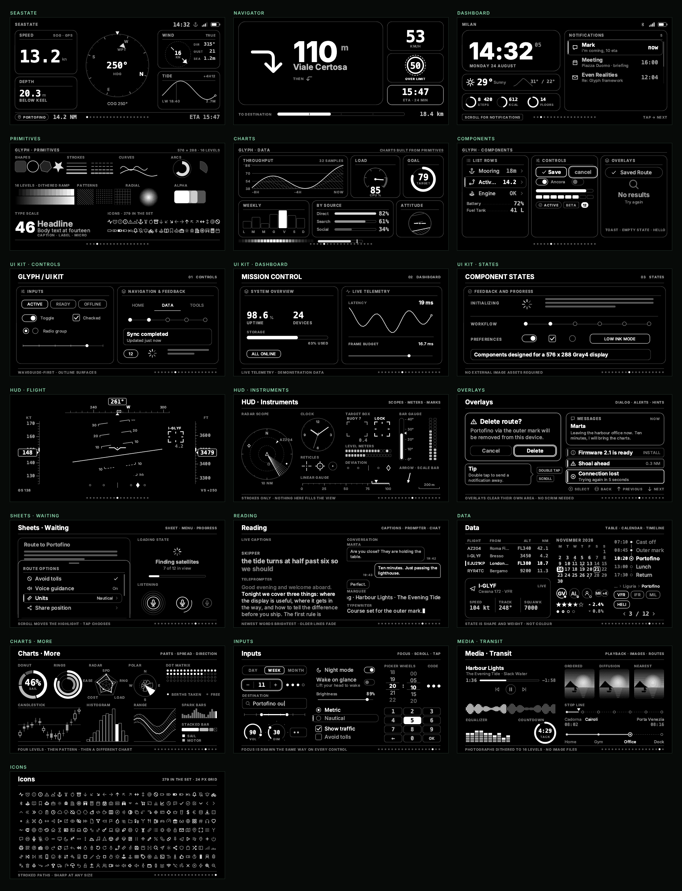

# Glyph

**A graphics and UI framework for Even Realities G2 smart glasses.**

Build interfaces with paths, text, charts, layouts, and reusable components. Glyph renders them into a **576 × 288 framebuffer with 16 grayscale levels**, splits the frame into image tiles, and updates the tiles that changed.

The rendering core is independent of the Even SDK. You can develop and test in a browser without glasses; the optional runtime connects your interface to the G2.

## Made with Glyph

### [OcuClaw](https://ocuclaw.com)


### [TideView](https://github.com/gabrielevierti/tideview)


### [G2ModelViewer](https://github.com/gabrielevierti/g2modelviewer)

A software 3D renderer that uses Glyph to display OBJ and GLB models on the G2.

## Try it locally

Clone the repository and start the browser preview:

```bash
git clone https://github.com/gabrielevierti/glyph.git
cd glyph
npm install
npm run dev
```

Open the URL printed by Vite. No glasses are required.

The preview includes navigation instruments, charts, and UI kit examples. Use its controls to compare outline and filled surfaces, inspect tile boundaries, adjust brightness, and check text contrast.

To regenerate the bitmap font atlas:

```bash
npm run font
```

Use a recent Node.js 22 release compatible with the project's Vite dependency. The additional Gray4 conversion test requires Node.js 22+.

The test and report scripts render in a real browser. `npx playwright install chromium` fetches one; to use a browser you already have, set `GLYPH_BROWSER_CHANNEL=chrome` or `GLYPH_BROWSER_PATH=/path/to/chrome`.

## What you can build

Glyph provides the drawing tools and the UI building blocks needed for compact grayscale interfaces: **123 components, 279 icons**, and the primitives underneath them.



| Area | Features |
|---|---|
| Drawing | Shapes, paths, Bézier curves, arrows, gradients, dithering, transforms, and clipping |
| Images | Photographs and artwork reduced to 16 levels with ordered or error-diffusion dithering |
| Text | Measurement, wrapping, truncation, automatic fitting, and bitmap fonts |
| Layout | Rows, columns, grids, intrinsic sizing, flexible sizing, and alignment |
| HUD instruments | Heading tape, value tapes, pitch ladder, reticles, target boxes, radar scope, clock face, level meters, linear and bar gauges |
| Navigation instruments | Compass rose, attitude indicator, wind indicator, speed limit, maneuver arrow, deviation bar, stop line |
| Overlays | Dialogs, bottom sheets, menus, callouts, banners, notifications, gesture hints |
| Reading | Live captions, teleprompter, chat bubbles, marquee, typewriter |
| Content | Cards, tables, timelines, calendars, avatars, ratings, breadcrumbs, pagination, media transport, waveforms |
| Inputs | Segmented control, picker wheel, dial, number stepper, text field, keypad, sliders, switch and slider rows, radio and check groups |
| Charts | Line, bar, scatter, sparkline, ring, gauge, heat-strip, bullet, donut, stacked bar, radar, polar, histogram, candlestick, range, dot matrix |
| Icons | 279 stroked icons on a 24px grid, plus your own |
| App structure | Screens, transitions, input routing, selection, and scrolling |
| Diagnostics | Ink reports, contrast checks, tile-layout analysis, and device benchmarks |

Every component is listed, with its parameters, in the **[component catalog](docs/COMPONENTS.md)**. The catalog is generated from the source, and each component appears on a reference screen in the preview.

## Draw your first frame

This example creates a frame using the library's public API:

```ts
import { GlyphFrame } from "@gabrielevierti/glyph";

const frame = new GlyphFrame({ supersample: 2 });

frame.draw((g) => {
  g.roundRect(
    { x: 16, y: 16, width: 240, height: 80 },
    14,
    { fill: 2, stroke: 8 }
  );

  g.text("13.2", 32, 44, { size: 40, weight: 800 }, 15);

  g.gradient(
    { x: 16, y: 110, width: 240, height: 40 },
    0,
    15
  );
});

const output = frame.toFrame();
```

Grayscale values are integers from `0` to `15`. The theme also provides named levels such as `surface`, `border`, `secondary`, `strong`, and `max`.

The example creates frame data. Displaying it on glasses requires an initialized `GlyphRuntime`; the repository's browser preview provides a separate way to inspect rendering locally.

`toLevels()` and `toFrame()` write into buffers the frame owns and reuses. The pixel data of a returned frame, and of its tiles, is valid until the next call — copy it with `Uint8Array.from(...)` if you need to keep a frame around.

## How it works

| Layer | Responsibility |
|---|---|
| Screens and components | Describe the interface |
| `GlyphRaster` | Draw primitives, text, and images |
| `GlyphFrame` | Resolve grayscale output, split tiles, pack Gray4, and compute hashes |
| `GlyphRuntime` | Compare frames and send changed tiles through the Even SDK |

The runtime has a separate entry point:

```ts
import { GlyphRuntime } from "@gabrielevierti/glyph/runtime";
```

Only this module imports `@evenrealities/even_hub_sdk`, which is an optional peer dependency. Browser rendering and core tests do not require a connection to the Even environment.

A complete app is a set of screens (described [below](#screens-and-application-flow)), an app shell, and a runtime:

```ts
import { GlyphApp } from "@gabrielevierti/glyph";
import { GlyphRuntime } from "@gabrielevierti/glyph/runtime";

const app = new GlyphApp({ screens: [depthScreen] });
app.start();                                  // paints, with or without glasses

const runtime = new GlyphRuntime();
await runtime.start();                        // waits for the Even Hub bridge
app.attachRuntime(runtime);
runtime.onInput((event) => app.handleInput(event));
```

If your app already holds a bridge from `waitForEvenAppBridge()`, pass it in — `new GlyphRuntime({ bridge })` — rather than waiting for a second one.

The current renderer uses browser canvas APIs. Standalone Node.js rendering is not provided.

## Designed for see-through displays

Small grayscale displays benefit from restrained fills, clear typography, and careful use of brightness.

Glyph defaults to an **outline** surface style: panels use borders, selection uses edge markers, and large chart regions use patterns rather than solid fills. A filled style is also available:

```ts
const frame = new GlyphFrame({ surface: "outline" });
const filledFrame = new GlyphFrame({ surface: "filled" });
```

Surface style belongs to each raster instance, so different styles can render side by side.

### Ink

The ink report measures average framebuffer intensity and the proportion of lit pixels. It helps compare how much visual content a screen adds.

For the six-screen reference set documented by the project:

| Metric | Filled | Outline |
|---|---:|---:|
| Mean intensity, relative to full brightness | 11.6% | 5.4% |
| Lit pixels | ~65% | ~12% |

Run `npm run ink` to generate results for the current screens.

These are framebuffer measurements. They do not directly measure optical occlusion, perceived readability, or device power consumption.

### Contrast

The contrast lint flags text whose grayscale level is too close to the sampled background:

```ts
const warnings = frame.raster.enableContrastLint(4);

// Render your content, then inspect warnings.
```

This catches common text/background clashes during development. It samples the rendered interface rather than the real scene behind the glasses, so on-device readability still needs checking.

## Components

A component is a function that takes the raster and a place to draw:

```ts
import { banner, dialog, headingTape, menu } from "@gabrielevierti/glyph";

headingTape(g, { x: 148, y: 10, width: 280, height: 46 }, heading, { bug: waypointBearing });
banner(g, { x: 20, y: 60, width: 260, height: 26 }, "Shoal ahead", { kind: "warning", detail: "0.3 NM" });
```

They hold no state and keep no tree. Call them from a screen's `render`, and what they draw is what is on the glasses.

### Without colour

A phone component says "selected", "warning" or "offline" with colour and with filled shapes. Neither is available here, so the library uses what is: weight of stroke, level of gray, dashed against solid, hollow against filled. A rising candle is hollow and a falling one solid. The travelled part of a route is a solid line and the rest is dashed. Presence is a solid dot, a barred dot, a ring, or a dim ring. Charts tell categories apart with four gray levels, then a hatch — and past that, the chart is asking to be a different chart.

### Overlays clear their own area

On a see-through display "off" is the only opaque colour. `dialog`, `bottomSheet`, `callout` and `notificationCard` clear the pixels beneath themselves before drawing, so they stay readable over a busy screen without a scrim dimming everything else.

### Focus instead of a pointer

The glasses report four gestures, so nothing is clickable: one control has focus, and the gestures act on it. Every input takes a `focused` flag and draws it the same way. Moving focus is the screen's job:

```ts
import { Cursor, menu, type MenuItem, type Screen } from "@gabrielevierti/glyph";

const items: MenuItem[] = [{ label: "Units", value: "Nautical", chevron: true }, { label: "Night mode", value: "Auto" }];
const box = { x: 20, y: 40, width: 240, height: 208 };
const cursor = new Cursor(items.length, 8);      // 8 rows of 26px fit in the box

export const settings: Screen = {
  name: "Settings",
  render({ g }) { menu(g, box, items, { cursor }); },
  onInput(event) {
    if (event.type === "scroll-down") cursor.move(1);
    else if (event.type === "scroll-up") cursor.move(-1);
    else return false;                            // taps fall through to the app
    return true;
  }
};
```

`pickerWheel`, `dial` and `numberStepper` are built around the scroll gesture and are the controls to reach for first.

### Images

`g.image(source, rect, options)` draws any `CanvasImageSource` — an ``, a canvas, an `ImageBitmap` — reduced to 16 levels:

```ts
g.image(albumArt, { x: 20, y: 20, width: 96, height: 96 }, { dither: "ordered", radius: 8, maxLevel: 12 });
```

`ordered` dithering is stable from frame to frame and is the default; `diffusion` is smoother on photographs but shimmers when the image moves. `maxLevel` keeps a bright photograph from flooding the view. An image from another origin must be served with CORS headers, or the browser will not allow its pixels to be read.

### Animated components

`marquee`, `loadingState`, `indeterminateBar` and `listeningIndicator` take the app clock (`now` from the render context) and need a screen marked `animated`. Remember what animation costs here: each changed tile is an image update over Bluetooth.

## Text and layout

Glyph supports both browser-rendered text and bitmap font atlases.

Bitmap atlases provide fixed glyph coverage and metrics for repeatable rendering. `npm run font` collects the text styles used by the example screens and generates atlas files in `public/fonts/`.

| Font mode | Behavior |
|---|---|
| `auto` | Use the bitmap atlas when a matching face exists; otherwise use canvas text |
| `bitmap` | Require an exact bitmap face; throw if it is missing |
| `canvas` | Use browser font rendering |

Bitmap lookup matches family, weight, size, and italic style. Glyph does not rescale a missing bitmap size automatically.

Committing an atlas keeps its bytes consistent across machines. Regenerating it can produce different results when the build machine resolves different fonts.

The atlas built from the reference screens ships with the package:

```ts
import { GlyphApp, loadFontSet } from "@gabrielevierti/glyph";
import atlasUrl from "@gabrielevierti/glyph/fonts/inter.json?url"; // Vite; other bundlers have an equivalent

const font = await loadFontSet(atlasUrl);
const app = new GlyphApp({ screens, font, fontMode: "auto" });
```

It covers the sizes and weights those screens use. In `auto` mode any other style falls back to canvas text; build your own atlas with `npm run font` to cover your app's styles.

Layout helpers return rectangles that you can use directly when drawing:

```ts
import { row, grow } from "@gabrielevierti/glyph";

const [sidebar, content] = row(
  { x: 16, y: 16, width: 544, height: 256 },
  [{ size: 120 }, { size: grow(1) }],
  { gap: 12 }
);
```

Rows and columns support fixed and flexible sizes, intrinsic measurements, bounds, gaps, padding, and alignment. Text helpers provide wrapping, truncation, and fitting within available space.

## Screens and application flow

`GlyphApp` manages screens, repaint scheduling, transitions, and input routing.

A screen is a plain object:

```ts
import type { Screen } from "@gabrielevierti/glyph";

export const depthScreen: Screen = {
  name: "Depth",
  animated: false,

  render({ g }) {
    g.text("DEPTH", 24, 24, { size: 16, weight: 600 }, 10);
    g.text("13.2 m", 24, 56, { size: 40, weight: 800 }, 15);
  },
};
```

Animated screens repaint on the app's timer. Static screens can update when invalidated. `Cursor` provides selection and scrolling behavior for list-based interfaces.

### Input

The runtime turns bridge events into six input events:

| Event | Source | Default in `GlyphApp` |
|---|---|---|
| `tap` | Single press | Next screen |
| `double-tap` | Double press | None |
| `scroll-down` / `scroll-up` | Swipe | Next / previous screen |
| `foreground-enter` | The app returns to the foreground | Repaint every tile |
| `foreground-exit` | The app leaves the foreground | None |

A screen's `onInput` sees every event first and returns `true` to keep it. Other bridge traffic — exit notices, IMU reports, audio — is not input and is not forwarded.

### When the phone is locked

Browsers stop `requestAnimationFrame` for hidden pages, and an Even Hub app runs in a WebView on a phone that is usually in a pocket. `GlyphApp` switches to a timer while the page is hidden and back when it is visible. Hosts throttle background timers, typically to about one per second, so a hidden app updates slowly rather than not at all. This behavior is covered by the browser suite; how a particular phone treats the WebView still needs checking on that phone.

Use `onSlowFrame` to identify expensive screen rendering, and inspect `app.transportStats` when connected to the runtime. Browser rendering speed and device update speed are separate measurements.

## Tile layouts and updates

Glyph targets a maximum of **four image containers per G2 page**. The simulator may accept configurations that do not work on the physical device, so validate layouts before deployment.

Several full-screen layouts are included:

| Layout | Tile arrangement | Useful for |
|---|---|---|
| `TILE_QUADRANTS` | Four 288 × 144 tiles | General-purpose layouts |
| `TILE_BANDS` | Four 576 × 72 strips | Horizontal sections |
| `TILE_COLUMNS` | Four 144 × 288 columns | Independent vertical panels |
| `TILE_CHROME` | One 576 × 32 strip and three 192 × 256 tiles | A persistent header |
| `TILE_HERO` | One 426 × 288 tile and three 150 × 96 tiles | A large main view with a side rail |

`validateLayout()` checks coverage, overlap, bounds, even widths, and the container limit.

Tile boundaries affect update cost: changing one pixel requires updating its entire tile. Place boundaries between regions that change at different rates.

### Choosing a layout

Run:

```bash
npm run tiles
```

The report compares layouts using packed Gray4 data as a cost model. These figures are useful for comparing tile arrangements; they are not measurements of PNG payload size or actual BLE throughput.

`ChangeRecorder` can also observe frame changes and suggest a layout. Its search evaluates guillotine tilings on a configurable grid. The preview's **optimise** control exposes this workflow interactively.

Layouts are fixed when the page is created. Applying a different layout requires rebuilding the page.

### Sending frames

The runtime hashes packed Gray4 tiles to detect changes and encodes tile updates as PNG for transport.

When rendering outpaces transport, the runtime keeps at most one pending frame and replaces it with newer output. Superseded pending frames are counted as dropped, preventing an ever-growing queue of stale frames.

A tile counts as changed when it differs from what the glasses will show once the write in progress completes. A tile that changes and reverts while its first update is still being sent is therefore sent again, rather than being skipped because it matches the last acknowledged state.

`runtime.stats` reports tiles sent and dropped, round-trip percentiles, the Gray4 size of what was sent (`bytes`), and the PNG size actually handed to the bridge (`encodedBytes`).

Actual update speed depends on tile content, encoding, the SDK, and the device connection. Measure it with the device benchmark.

## Run on G2

Start a server accessible on your local network:

```bash
npm run host
npx evenhub qr --url http://YOUR_LAN_IP:5173
```

Keep your computer and phone on the same network. Scan the QR code through the Even companion app with your G2 paired.

To use the simulator, run these commands in separate terminals:

```bash
npm run dev
```

```bash
npm run sim
```

To create an Even Hub package:

```bash
npm run pack
```

## Testing and diagnostics

| Command | Purpose |
|---|---|
| `npm run check` | Run everything CI runs: typecheck, both test layers, library build |
| `npm test` | Run the browser-based test suite |
| `npm run typecheck` | Check TypeScript types |
| `npm run build:lib` | Build the library |
| `npm run ink` | Report screen intensity and lit-pixel coverage |
| `npm run tiles` | Compare tile layouts and evaluate layout suggestions |
| `npm run snapshot` | Regenerate reference screenshots |
| `npm run font` | Regenerate bitmap font atlases |
| `npm run catalog` | Regenerate `docs/COMPONENTS.md` from the source |
| `npm run test:gray-fast` | Check Gray4 conversion and packing; requires Node.js 22+ |
| `npm run bench` | Measure transport behavior with a paired device |

The browser suite covers rendering, Gray4 packing, tile validation, text measurement, layout, screen behavior, ink and contrast budgets, and the transport — exercised against a recording stand-in for the Even bridge, including slow, failing, and interrupted connections.

`lib/` is committed so the package can be installed directly from GitHub. CI rebuilds it and fails if the committed copy is out of date, so run `npm run build:lib` before committing a change to `src/glyph`.

The device benchmark reports update latency, throughput, and dropped frames. Improvements to browser preview rendering should be measured separately from improvements to wireless transport.

## Current limitations

- **Device transport needs hardware testing.** The browser suite checks the transport's logic against a simulated bridge. It does not establish correctness or performance on physical glasses.
- **Rendering requires a browser canvas environment.** A standalone Node.js backend is not included.
- **Some components assume the G2 dimensions.** For example, `statusBar` assumes a 576-pixel-wide surface.
- **Updates operate on whole tiles.** Small changes can still trigger comparatively large image updates.
- **Tile layouts are fixed for the lifetime of a page.**
- **Font atlas generation depends on the build environment.** Keep generated assets under version control when reproducibility matters.
- **Ink budgets and contrast checks are diagnostics.** They do not enforce rendering restrictions or guarantee readability on glasses.
- **The component library has been checked in a browser, not on glasses.** Every component is rendered, measured for ink and contrast, and fed degenerate data by the suite. How each one reads through a waveguide — especially the smallest type and the finest strokes — still needs checking on hardware.
- **The shipped font atlas covers the reference screens' type sizes.** Components use only those sizes, so they render from the atlas. A custom size in `auto` mode falls back to canvas text until you rebuild the atlas.
- **Images need readable pixels.** `image()` cannot draw a cross-origin image served without CORS headers.

## Contributing

Bug reports, example applications, rendering fixes, and device measurements are welcome.

For rendering issues, include a minimal example and a screenshot. For device issues, include the SDK and firmware versions, tile layout, expected behavior, and observed behavior.

When reporting a performance improvement, specify what was measured: rendering time, encoded payload size, update latency, or device throughput.

## License

MIT. See [LICENSE](LICENSE).