<div align="center">

<picture>
  <source media="(prefers-color-scheme: dark)" srcset="img/readme/banner-dark.svg">
  
</picture>

<p>
  <a href="#quick-start"><b>Quick start</b></a> ·
  <a href="#what-you-can-build"><b>What you can build</b></a> ·
  <a href="#how-it-works"><b>How it works</b></a> ·
  <a href="#run-on-g2"><b>Run on G2</b></a> ·
  <a href="docs/COMPONENTS.md"><b>Component catalog</b></a>
</p>

</div>

Glyph is a graphics and UI framework for **Even Realities G2** smart glasses. You describe an interface with paths, text, charts, layouts and ready-made components; Glyph renders it into a **576 × 288 framebuffer with 16 gray levels**, splits the frame into image tiles and sends only the tiles that changed.

The rendering core does not depend on the Even SDK, so you can design and test an entire app in a browser without glasses. When you are ready, the optional runtime connects the same app to the G2.

<picture>
  <source media="(prefers-color-scheme: dark)" srcset="img/readme/features-dark.svg">
  
</picture>

## Made with Glyph

<table>
  <tr>
    <td width="30%"><b><a href="https://ocuclaw.com">OcuClaw</a></b></td>
    <td></td>
  </tr>
  <tr>
    <td><b><a href="https://github.com/gabrielevierti/tideview">TideView</a></b><br><sub>Marine conditions HUD</sub></td>
    <td></td>
  </tr>
  <tr>
    <td><b><a href="https://github.com/gabrielevierti/g2modelviewer">G2ModelViewer</a></b></td>
    <td>A software 3D renderer that uses Glyph to show OBJ and GLB models on the G2.</td>
  </tr>
</table>

## Quick start

Clone the repository and open the browser preview. No glasses needed.

```bash
git clone https://github.com/gabrielevierti/glyph.git
cd glyph
npm install
npm run dev
```

Open the URL Vite prints. The preview shows navigation instruments, charts and the UI kit, with controls to switch between outline and filled surfaces, show tile boundaries, change brightness and check text contrast.

**Requirements.** A recent Node.js 22 release that works with the project's Vite version (the extra Gray4 conversion test needs Node.js 22+). Tests and reports render in a real browser: `npx playwright install chromium` downloads one, or point Glyph at a browser you already have with `GLYPH_BROWSER_CHANNEL=chrome` or `GLYPH_BROWSER_PATH=/path/to/chrome`.

**Use it in your app.** The built `lib/` folder is committed, so the package installs straight from GitHub:

```bash
npm install gabrielevierti/glyph
```

### Draw your first frame

```ts
import { GlyphFrame } from "@gabrielevierti/glyph";

const frame = new GlyphFrame({ supersample: 2 });

frame.draw((g) => {
  g.roundRect({ x: 16, y: 16, width: 240, height: 80 }, 14, { fill: 2, stroke: 8 });
  g.text("13.2", 32, 44, { size: 40, weight: 800 }, 15);
  g.gradient({ x: 16, y: 110, width: 240, height: 40 }, 0, 15);
});

const output = frame.toFrame();
```

Gray levels are integers from `0` to `15`; the theme also names levels such as `surface`, `border`, `secondary`, `strong` and `max`.

This produces frame data. To show it on glasses you need an initialized `GlyphRuntime` (see [How it works](#how-it-works)); locally, the browser preview is the way to inspect it.

> [!NOTE]
> `toLevels()` and `toFrame()` write into buffers the frame owns and reuses. A returned frame's pixels, and its tiles' pixels, stay valid until the next call: copy them with `Uint8Array.from(...)` if you need to keep them.

## What you can build

Glyph ships the drawing tools and the building blocks for compact grayscale interfaces: **123 components, 279 icons** and the primitives underneath them.


| Area | What's included |
|---|---|
| **Drawing** | Shapes, paths, Bézier curves, arrows, gradients, dithering, transforms, clipping |
| **Images** | Photos and artwork reduced to 16 levels with ordered or error-diffusion dithering |
| **Text** | Measuring, wrapping, truncation, automatic fitting, bitmap fonts |
| **Layout** | Rows, columns, grids, intrinsic and flexible sizing, alignment |
| **HUD instruments** | Heading tape, value tapes, pitch ladder, reticles, target boxes, radar scope, clock face, level meters, linear and bar gauges |
| **Navigation instruments** | Compass rose, attitude indicator, wind indicator, speed limit, maneuver arrow, deviation bar, stop line |
| **Overlays** | Dialogs, bottom sheets, menus, callouts, banners, notifications, gesture hints |
| **Reading** | Live captions, teleprompter, chat bubbles, marquee, typewriter |
| **Content** | Cards, tables, timelines, calendars, avatars, ratings, breadcrumbs, pagination, media transport, waveforms |
| **Inputs** | Segmented control, picker wheel, dial, number stepper, text field, keypad, sliders, switch and slider rows, radio and check groups |
| **Charts** | Line, bar, scatter, sparkline, ring, gauge, heat strip, bullet, donut, stacked bar, radar, polar, histogram, candlestick, range, dot matrix |
| **Icons** | 279 stroked icons on a 24 px grid, plus your own |
| **App structure** | Screens, transitions, input routing, selection, scrolling |
| **Diagnostics** | Ink reports, contrast checks, tile-layout analysis, device benchmarks |

Every component and its parameters is listed in the **[component catalog](docs/COMPONENTS.md)**, generated from the source. Each one also appears on a reference screen in the preview.

## How it works

| Layer | Job |
|---|---|
| **Screens and components** | Describe the interface |
| **`GlyphRaster`** | Draws primitives, text and images |
| **`GlyphFrame`** | Resolves gray levels, splits tiles, packs Gray4, computes hashes |
| **`GlyphRuntime`** | Compares frames and sends changed tiles through the Even SDK |

The runtime has its own entry point, and it is the only module that imports `@evenrealities/even_hub_sdk` (an optional peer dependency). Browser rendering and the core tests never need the Even environment.

```ts
import { GlyphRuntime } from "@gabrielevierti/glyph/runtime";
```

A complete app is a set of [screens](#screens-and-input), an app shell and a runtime:

```ts
import { GlyphApp } from "@gabrielevierti/glyph";
import { GlyphRuntime } from "@gabrielevierti/glyph/runtime";

const app = new GlyphApp({ screens: [depthScreen] });
app.start();                                  // paints, with or without glasses

const runtime = new GlyphRuntime();
await runtime.start();                        // waits for the Even Hub bridge
app.attachRuntime(runtime);
runtime.onInput((event) => app.handleInput(event));
```

If your app already holds a bridge from `waitForEvenAppBridge()`, pass it in with `new GlyphRuntime({ bridge })` instead of waiting for a second one.

The renderer uses browser canvas APIs; standalone Node.js rendering is not provided.

## Designed for see-through displays

On a small grayscale display, restraint is what keeps things readable: light fills, clear type, careful brightness.

Glyph defaults to an **outline** surface style. Panels use borders, selection uses edge markers, and large chart areas use patterns instead of solid fills. A filled style is available too, and the choice belongs to each raster, so both can render side by side:

```ts
const frame = new GlyphFrame({ surface: "outline" });
const filledFrame = new GlyphFrame({ surface: "filled" });
```

**Ink.** The ink report measures average framebuffer intensity and the share of lit pixels, so you can see how much a screen adds to the view. On the project's six reference screens:

| Metric | Filled | Outline |
|---|---:|---:|
| Mean intensity, relative to full brightness | 11.6% | 5.4% |
| Lit pixels | ~65% | ~12% |

Run `npm run ink` to measure your current screens. These are framebuffer figures: they do not measure optical occlusion, perceived readability or power draw.

**Contrast.** The contrast lint flags text whose gray level is too close to the background it is drawn on:

```ts
const warnings = frame.raster.enableContrastLint(4);
// Render your content, then inspect warnings.
```

It samples the rendered interface, not the real scene behind the lens, so readability still needs a check on the glasses.

## Components

A component is a plain function that takes the raster and a place to draw:

```ts
import { banner, dialog, headingTape, menu } from "@gabrielevierti/glyph";

headingTape(g, { x: 148, y: 10, width: 280, height: 46 }, heading, { bug: waypointBearing });
banner(g, { x: 20, y: 60, width: 260, height: 26 }, "Shoal ahead", { kind: "warning", detail: "0.3 NM" });
```

Components hold no state and build no tree. Call them from a screen's `render`, and what they draw is what appears on the glasses.

**Without colour.** A phone UI says "selected", "warning" or "offline" with colour and filled shapes; neither is available here. Glyph uses what is: stroke weight, gray level, dashed against solid, hollow against filled. A rising candle is hollow and a falling one solid; the travelled part of a route is solid and the rest dashed; presence is a solid dot, a barred dot, a ring or a dim ring. Charts separate categories with four gray levels and then a hatch. Beyond that, the chart should be a different chart.

**Overlays clear their own area.** On a see-through display, "off" is the only opaque colour. `dialog`, `bottomSheet`, `callout` and `notificationCard` clear the pixels underneath before drawing, so they stay readable over a busy screen without dimming everything else.

**Focus instead of a pointer.** The glasses report four gestures and nothing is clickable: one control has focus and the gestures act on it. Every input takes a `focused` flag and draws it the same way; moving focus is the screen's job.

```ts
import { Cursor, menu, type MenuItem, type Screen } from "@gabrielevierti/glyph";

const items: MenuItem[] = [{ label: "Units", value: "Nautical", chevron: true }, { label: "Night mode", value: "Auto" }];
const box = { x: 20, y: 40, width: 240, height: 208 };
const cursor = new Cursor(items.length, 8);      // 8 rows of 26px fit in the box

export const settings: Screen = {
  name: "Settings",
  render({ g }) { menu(g, box, items, { cursor }); },
  onInput(event) {
    if (event.type === "scroll-down") cursor.move(1);
    else if (event.type === "scroll-up") cursor.move(-1);
    else return false;                            // taps fall through to the app
    return true;
  }
};
```

`pickerWheel`, `dial` and `numberStepper` are built around the scroll gesture: reach for them first.

**Images.** `g.image(source, rect, options)` draws any `CanvasImageSource` (an ``, a canvas, an `ImageBitmap`) reduced to 16 levels:

```ts
g.image(albumArt, { x: 20, y: 20, width: 96, height: 96 }, { dither: "ordered", radius: 8, maxLevel: 12 });
```

`ordered` dithering is the default and stays stable from frame to frame; `diffusion` is smoother on photos but shimmers when the image moves. `maxLevel` stops a bright photo from flooding the view. Images from another origin must be served with CORS headers, or the browser won't let Glyph read their pixels.

**Animated components.** `marquee`, `loadingState`, `indeterminateBar` and `listeningIndicator` take the app clock (`now` from the render context) and need a screen marked `animated`. Keep the cost in mind: every changed tile is an image update over Bluetooth.

## Text and layout

Glyph supports both browser-rendered text and bitmap font atlases. Atlases give fixed glyph coverage and metrics, so rendering is repeatable. `npm run font` collects the text styles used by the example screens and writes atlases to `public/fonts/`.

| Font mode | Behaviour |
|---|---|
| `auto` | Uses the bitmap atlas when a matching face exists, canvas text otherwise |
| `bitmap` | Requires an exact bitmap face and throws if it is missing |
| `canvas` | Uses browser font rendering |

Bitmap lookup matches family, weight, size and italic; a missing size is not rescaled. Committing an atlas keeps its bytes identical across machines, while regenerating it can differ when the build machine resolves different fonts.

The atlas built from the reference screens ships with the package:

```ts
import { GlyphApp, loadFontSet } from "@gabrielevierti/glyph";
import atlasUrl from "@gabrielevierti/glyph/fonts/inter.json?url"; // Vite; other bundlers have an equivalent

const font = await loadFontSet(atlasUrl);
const app = new GlyphApp({ screens, font, fontMode: "auto" });
```

It covers the sizes and weights those screens use. In `auto` mode any other style falls back to canvas text; run `npm run font` to build an atlas for your own styles.

Layout helpers return rectangles you can draw into directly:

```ts
import { row, grow } from "@gabrielevierti/glyph";

const [sidebar, content] = row(
  { x: 16, y: 16, width: 544, height: 256 },
  [{ size: 120 }, { size: grow(1) }],
  { gap: 12 }
);
```

Rows and columns support fixed and flexible sizes, intrinsic measurement, bounds, gaps, padding and alignment. Text helpers handle wrapping, truncation and fitting.

## Screens and input

`GlyphApp` manages screens, repaint scheduling, transitions and input routing. A screen is a plain object:

```ts
import type { Screen } from "@gabrielevierti/glyph";

export const depthScreen: Screen = {
  name: "Depth",
  animated: false,

  render({ g }) {
    g.text("DEPTH", 24, 24, { size: 16, weight: 600 }, 10);
    g.text("13.2 m", 24, 56, { size: 40, weight: 800 }, 15);
  },
};
```

Animated screens repaint on the app's timer; static screens update when invalidated. `Cursor` provides selection and scrolling for list-based interfaces.

The runtime turns bridge events into six input events. A screen's `onInput` sees each one first and returns `true` to keep it.

| Event | Source | Default in `GlyphApp` |
|---|---|---|
| `tap` | Single press | Next screen |
| `double-tap` | Double press | None |
| `scroll-down` / `scroll-up` | Swipe | Next / previous screen |
| `foreground-enter` | App returns to the foreground | Repaint every tile |
| `foreground-exit` | App leaves the foreground | None |

Other bridge traffic (exit notices, IMU reports, audio) is not input and is not forwarded.

**When the phone is locked.** Browsers stop `requestAnimationFrame` on hidden pages, and an Even Hub app runs in a WebView on a phone that is usually in a pocket. `GlyphApp` switches to a timer while the page is hidden and back when it is visible. Hosts usually throttle background timers to about once a second, so a hidden app updates slowly rather than not at all. The browser suite covers this; how a specific phone treats the WebView still needs checking on that phone.

Use `onSlowFrame` to find expensive screens, and `app.transportStats` when connected to the runtime. Browser rendering speed and device update speed are separate measurements.

## Tiles and updates

Glyph targets at most **four image containers per G2 page**. The simulator may accept layouts the physical device rejects, so validate before you ship.

| Layout | Tiles | Good for |
|---|---|---|
| `TILE_QUADRANTS` | Four 288 × 144 tiles | General layouts |
| `TILE_BANDS` | Four 576 × 72 strips | Horizontal sections |
| `TILE_COLUMNS` | Four 144 × 288 columns | Independent vertical panels |
| `TILE_CHROME` | One 576 × 32 strip and three 192 × 256 tiles | A persistent header |
| `TILE_HERO` | One 426 × 288 tile and three 150 × 96 tiles | A large main view with a side rail |

`validateLayout()` checks coverage, overlap, bounds, even widths and the container limit. Because changing one pixel re-sends its whole tile, put tile boundaries between regions that change at different rates. Layouts are fixed when the page is created; switching layout means rebuilding the page.

<details>
<summary><b>Choosing a layout and how frames are sent</b></summary>

<br>

`npm run tiles` compares layouts using packed Gray4 data as a cost model. The figures are for comparing arrangements; they are not PNG payload sizes or measured BLE throughput. `ChangeRecorder` can also watch frame changes and suggest a layout by searching guillotine tilings on a configurable grid; the preview's **optimise** control runs this interactively.

The runtime hashes packed Gray4 tiles to detect changes and encodes updates as PNG for transport. When rendering outpaces transport, it keeps at most one pending frame and replaces it with newer output; superseded frames are counted as dropped, so stale frames never queue up.

A tile counts as changed when it differs from what the glasses will show once the write in progress completes. A tile that changes and reverts while its first update is still in flight is therefore sent again, rather than skipped for matching the last acknowledged state.

`runtime.stats` reports tiles sent and dropped, round-trip percentiles, the Gray4 size of what was sent (`bytes`) and the PNG size handed to the bridge (`encodedBytes`). Real update speed depends on tile content, encoding, the SDK and the connection: measure it with the device benchmark.

</details>

## Run on G2

Serve the app on your local network and open it through the Even companion app, with your G2 paired and the phone on the same network:

```bash
npm run host
npx evenhub qr --url http://YOUR_LAN_IP:5173
```

To use the simulator instead, run these in two terminals:

```bash
npm run dev
```

```bash
npm run sim
```

To build an Even Hub package:

```bash
npm run pack
```

## Testing and diagnostics

| Command | What it does |
|---|---|
| `npm run check` | Everything CI runs: typecheck, both test layers, library build |
| `npm test` | Browser-based test suite |
| `npm run typecheck` | TypeScript type check |
| `npm run build:lib` | Builds the library |
| `npm run ink` | Screen intensity and lit-pixel report |
| `npm run tiles` | Compares tile layouts and evaluates suggestions |
| `npm run snapshot` | Regenerates reference screenshots |
| `npm run font` | Regenerates bitmap font atlases |
| `npm run catalog` | Regenerates `docs/COMPONENTS.md` from the source |
| `npm run test:gray-fast` | Checks Gray4 conversion and packing (Node.js 22+) |
| `npm run bench` | Measures transport behaviour with a paired device |

The browser suite covers rendering, Gray4 packing, tile validation, text measurement, layout, screen behaviour, ink and contrast budgets, and the transport, exercised against a recording stand-in for the Even bridge, including slow, failing and interrupted connections.

`lib/` is committed so the package can be installed from GitHub. CI rebuilds it and fails if the committed copy is stale, so run `npm run build:lib` before committing changes to `src/glyph`.

The device benchmark reports update latency, throughput and dropped frames. Measure browser rendering improvements separately from wireless transport improvements.

## Current limitations

- **Device transport needs hardware testing.** The suite checks the transport's logic against a simulated bridge, not correctness or performance on real glasses.
- **Rendering needs a browser canvas.** There is no standalone Node.js backend.
- **Some components assume G2 dimensions.** For example, `statusBar` expects a 576-pixel-wide surface.
- **Updates work on whole tiles.** A small change can still trigger a comparatively large image update.
- **Tile layouts are fixed for the lifetime of a page.**
- **Font atlases depend on the build machine.** Keep generated atlases in version control when reproducibility matters.
- **Ink budgets and contrast checks are diagnostics.** They don't restrict rendering or guarantee readability on glasses.
- **Components have been checked in a browser, not on glasses.** Each one is rendered, measured for ink and contrast and fed degenerate data by the suite; how it reads through a waveguide, especially the smallest type and finest strokes, still needs hardware checks.
- **The shipped atlas covers the reference screens' type sizes.** Components only use those sizes; a custom size in `auto` mode falls back to canvas text until you rebuild the atlas.
- **Images need readable pixels.** `image()` cannot draw a cross-origin image served without CORS headers.

## Contributing

Bug reports, example apps, rendering fixes and device measurements are all welcome.

- **Rendering issues:** include a minimal example and a screenshot.
- **Device issues:** include SDK and firmware versions, the tile layout, and what you expected versus what happened.
- **Performance improvements:** say what you measured: rendering time, encoded payload size, update latency or device throughput.

## License

MIT. See [LICENSE](LICENSE).

---

<sub>Made by <a href="https://github.com/gabrielevierti">Gabriele Vierti</a> in Milan.</sub>
